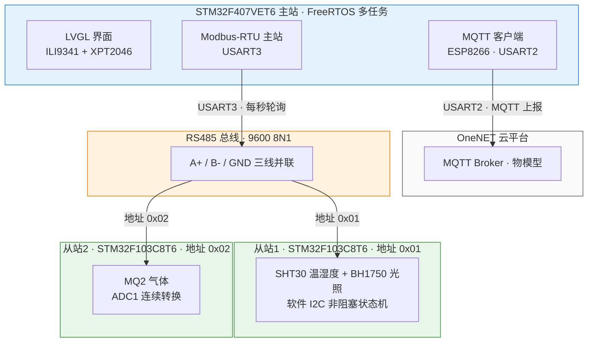

# 基于 FreeRTOS + LVGL 的 Modbus-RTU 分布式物联网环境监测系统

以 **STM32F407 主站 + 双 STM32F103 从站** 构建的分布式环境监测终端：主站通过 **RS485 / Modbus-RTU** 总线轮询两个从站，采集温湿度、光照、气体三类环境数据，经 **ESP8266** 接入 **OneNET** 物联网平台实现云端上报。主站配备 2.8 寸 TFT 触摸屏，基于 **LVGL** 构建图形交互界面，软件采用 **FreeRTOS** 多任务调度，实现 Modbus 采集、MQTT 通信、显示刷新与低功耗管理之间的高效协同。

---

## 系统架构


---

## 硬件清单

| 模块 | 型号 | 接口 | 说明 |
|------|------|------|------|
| 主控（主站） | STM32F407VET6 | — | Cortex-M4 @ 168MHz，512KB Flash / 192KB RAM |
| 从站1 | STM32F103C8T6 | USART1 + RS485 | Modbus 地址 0x01，负责温湿度 + 光照 |
| 从站2 | STM32F103C8T6 | USART1 + RS485 | Modbus 地址 0x02，负责气体检测 |
| RS485 模块 | 隔离型（自动方向） | TTL + A/B | TTL 侧与 MCU **同向直连** |
| 显示屏 | MSP2807 (ILI9341) | SPI1 + DMA | 2.8 寸 TFT，240×320 分辨率 |
| 触摸 | XPT2046 | SPI + EXTI | 电阻式触摸，中断唤醒 |
| WiFi | ESP8266 (ESP-01S) | USART2 | AT 指令驱动，MQTT 通信 |
| 温湿度 | SHT30 | 软件 I2C（PB6/PB7） | 挂在从站1 |
| 光照 | BH1750 | 软件 I2C（PB6/PB7） | 挂在从站1 |
| 气体 | MQ2 | ADC1 | 挂在从站2 |

---

## 功能特性

### 分布式 Modbus-RTU 采集
- 主站 USART3 作 Modbus-RTU 主站（9600 8N1），每秒轮询两个从站（`Modbus_Master_PollAll`）
- 从站使用**轮询式收发**，软件实现：
  - CRC16 逐位校验（0xA001）
  - 帧首字节地址过滤（非本机地址整帧丢弃）
  - 3.5 字符空闲时间判帧（9600bps 下约 4ms，代码取 5ms 空闲阈值）
  - 非法数据地址 / 非法功能码异常应答（0x83+02、0x8X+01）
- 从站1 传感器刷新采用**非阻塞状态机**（SHT30/BH1750 软件 I2C），从站2 采用 **ADC1 连续转换**直接读取

### LVGL 图形交互界面
- **滑动解锁锁屏**：设备上电进入锁屏界面，滑块拖动解锁，未达阈值松手自动回弹，背光超时自动锁屏


- **三页式布局**：数据展示页（2×2 传感器卡片）、系统设置页（自动刷新开关 / 数据上传开关、锁屏按钮）、设备信息页

| 数据展示页 | 系统设置页 | 设备信息页 |
|:---:|:---:|:---:|
|  |  | 
- **传感器详情页**：点击卡片进入，折线图展示 60 点历史数据，底部统计面板显示当前值 / 最大值 / 最小值 / 平均值，支持单传感器暂停 / 继续

| 温度 | 湿度 | 光照 | 空气质量 |
|:---:|:---:|:---:|:---:|
|  |  |  |  |

### 数据可视化算法
- **环形缓冲区**：固定容量 60 点，新数据覆盖最旧数据，无需动态内存分配
- **线性插值**：将 60 个采样点插值至 120 个显示点，曲线平滑无阶梯感
- **动态 Y 轴量程**：根据数据极值自动计算绘图范围，上下各留 10% 边距，数据波动小时不会挤成直线
- **自适应小数位数**：Y 轴刻度根据量程自动选择 0/1/2 位小数

### MQTT 云端上报
- 接入 OneNET 物联网平台物模型，JSON 格式上报温度 / 湿度 / 光照 / 气体数据
- 每 10 秒上传一次，订阅平台回复主题确认投递结果
- **三级断连自愈状态机**：正常上报 → MQTT 重连 → WiFi 重连，连续 3 次失败自动检测链路层级并触发 ESP8266 软复位，确保网络异常后系统可自动恢复

### 低功耗管理
- **FreeRTOS Tickless Idle**：系统空闲时自动进入 WFI 睡眠，消除空闲节拍中断功耗
- **背光智能管理**：60 秒无触摸操作自动关闭背光并锁屏，触摸 EXTI 中断（PC2）实时唤醒
- 配置数据上传开关，关闭时跳过 MQTT 发布，减少无线通信功耗

---

## Modbus 通信协议

### 帧格式（RTU）

```
请求： [从站地址][功能码03][起始地址 2B][寄存器数量 2B][CRC16 低字节][CRC16 高字节]
应答： [从站地址][功能码03][数据字节数][数据 2B×N][CRC16 低字节][CRC16 高字节]
```

### 寄存器映射

| 从站 | 地址 | 寄存器 | 内容 | 换算 |
|------|------|--------|------|------|
| 从站1 | 0x01 | 0 | 温度 | 原始值 ÷ 10 = ℃ |
| 从站1 | 0x01 | 1 | 湿度 | 原始值 ÷ 10 = %RH |
| 从站1 | 0x01 | 2 | 光照高 16 位 | 与寄存器3合成 lux×1000 |
| 从站1 | 0x01 | 3 | 光照低 16 位 | 与寄存器2合成 lux×1000 |
| 从站2 | 0x02 | 0 | 气体 ADC | 原始 ADC 值 |


---

## FreeRTOS 任务划分（主站）

| 任务 | 优先级 | 栈大小 | 说明 |
|------|--------|--------|------|
| 触摸扫描 | 4 | 128 字 | EXTI 中断唤醒后扫描 XPT2046，支持拖动 |
| LVGL 界面刷新 | 3 | 2048 字 | lv_task_handler 调度、读全局数据每秒刷新 UI |
| 传感器采集 | 2 | 128 字 | 每秒轮询 Modbus 从站，更新全局数据 |
| MQTT 上传 | 2 | 512 字 | 三级状态机管理 WiFi/MQTT 连接与数据上报 |


### 任务间通信
- **全局共享数据**：主站轮询结果经 `SensorData_Update` 写入全局当前值与环形缓冲区；数据读写函数内部使用临界区保护（`SensorData_Update` / `SensorData_GetCurrent`），防止多任务读写撕裂；LVGL 界面任务每秒读取全局刷新卡片与曲线
- **任务通知**：触摸 EXTI 中断 → 触摸扫描任务，零开销唤醒

---

## 项目结构

```
├── Master/                          # 主站工程 (STM32F407VET6)
│   ├── Core/
│   │   ├── Inc/ Src/                # HAL 外设初始化
│   │   └── Hardware/
│   │       ├── modbus.c/h           # Modbus-RTU 主站（USART3 轮询 + CRC16）
│   │       ├── sensor_data.c/h      # 环形缓冲区与传感器数据管理
│   │       ├── user_task.c/h        # FreeRTOS 任务定义与调度
│   │       ├── esp8266.c/h          # ESP8266 WiFi + MQTT 驱动（AT 指令）
│   │       ├── LCD.c/h              # ILI9341 TFT 驱动（SPI + DMA）
│   │       ├── XPT2046.c/h          # XPT2046 触摸驱动
│   │       └── touch.c/h            # 触摸扫描与校准
│   ├── FreeRTOS/                    # FreeRTOS 源码与配置（Tickless Idle）
│   ├── LVGL/
│   │   ├── GUI/lvgl/                # LVGL v8.4.0 源码
│   │   └── GUI_APP/my_demos/
│   │       └── ui_demo_01.c/h       # 应用界面（锁屏 / 三页布局 / 折线图）
│   ├── Drivers/                     # STM32 HAL 驱动与 CMSIS
│   └── MDK-ARM/                     # Keil 工程文件
├── Slave01/                         # 从站1 工程 (STM32F103C8T6, 地址 0x01)
│   ├── Core/                        # HAL 初始化
│   ├── modbus/
│   │   ├── modbus_slave.c/h         # Modbus-RTU 从站（轮询收发 + CRC16）
│   │   └── sensor.c/h               # SHT30 + BH1750 驱动（软件 I2C 非阻塞）
│   └── MDK-ARM/                     # Keil 工程文件
├── Slave02/                         # 从站2 工程 (STM32F103C8T6, 地址 0x02)
│   ├── Core/                        # HAL 初始化（ADC1 连续转换）
│   ├── modbus/
│   │   ├── modbus_slave.c/h         # Modbus-RTU 从站
│   │   └── sensor.c/h               # MQ2 气体驱动（ADC 采样）
│   └── MDK-ARM/                     # Keil 工程文件
└── README.md
```

---

## 快速开始

### 编译与烧录
1. 打开对应工程的 `MDK-ARM/*.uvprojx`（Master / Slave01 / Slave02 三个工程分别编译）
2. 编译工程
3. 通过 ST-Link 烧录主站和两个从站

### 硬件接线

#### RS485 总线（主站 ↔ 从站）
| 信号 | 连接 |
|------|------|
| A（A+） | 三个模块的 A 端并联 |
| B（B-） | 三个模块的 B 端并联 |
| GND | 三个模块的电源地共地 |

### WiFi 与云平台配置

在 `Master/Core/Hardware/esp8266.h` 中修改以下配置：

```c
// WiFi
#define WIFI_SSID       "你的WiFi名称"
#define WIFI_PASSWORD   "你的WiFi密码"
// OneNET MQTT
#define MQTT_BROKER_HOST    "mqtts.heclouds.com"
#define MQTT_BROKER_PORT    1883
#define MQTT_CLIENT_ID      "你的设备名称"
#define MQTT_USERNAME       "你的产品ID"
#define MQTT_PASSWORD       "你的设备令牌(MD5签名)"
#define MQTT_PUBLISH_TOPIC  "$sys/产品ID/设备名称/thing/property/post"
```

### 操作说明
- **锁屏**：向右滑动滑块解锁，60 秒无操作自动锁屏，触摸唤醒
- **展示页**：查看四路传感器实时数值，点击卡片进入历史折线图详情
- **设置页**：开关自动刷新 / 数据上传，手动锁屏
- **设备页**：查看硬件与固件版本信息
- **底部 Tab 栏**：切换三个页面

---

## 许可证

本项目仅供学习交流使用。
